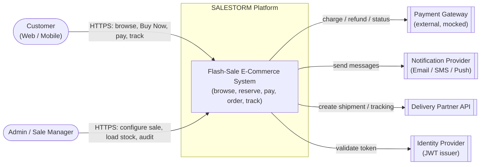
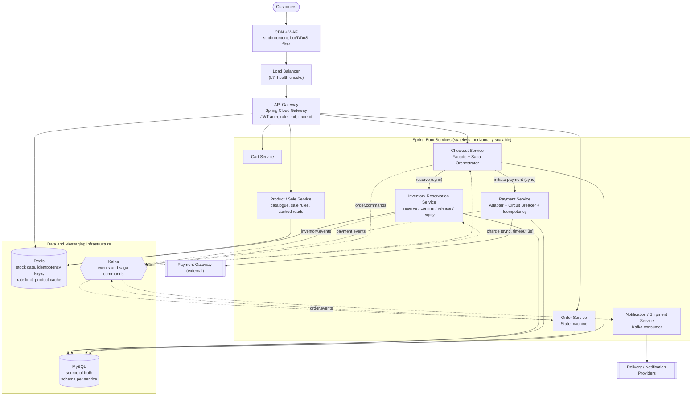
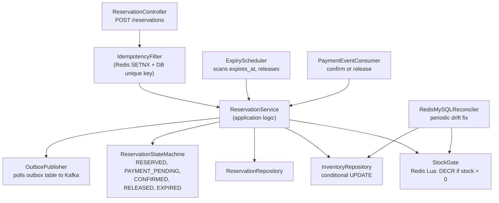
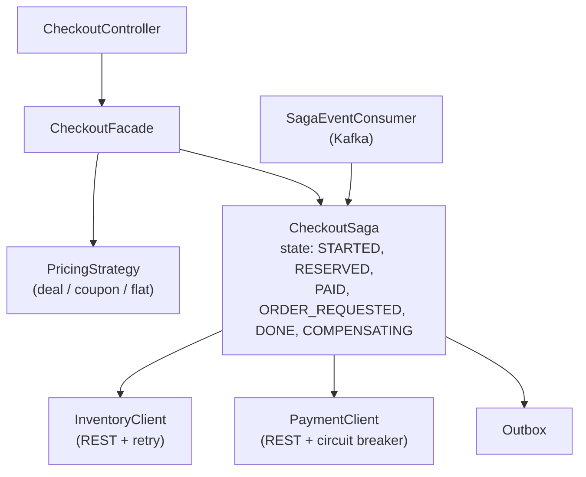
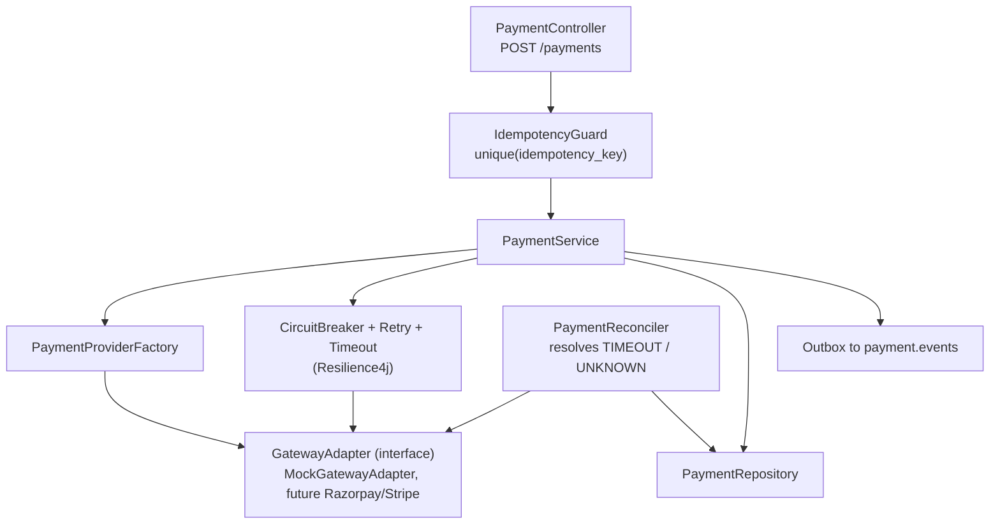
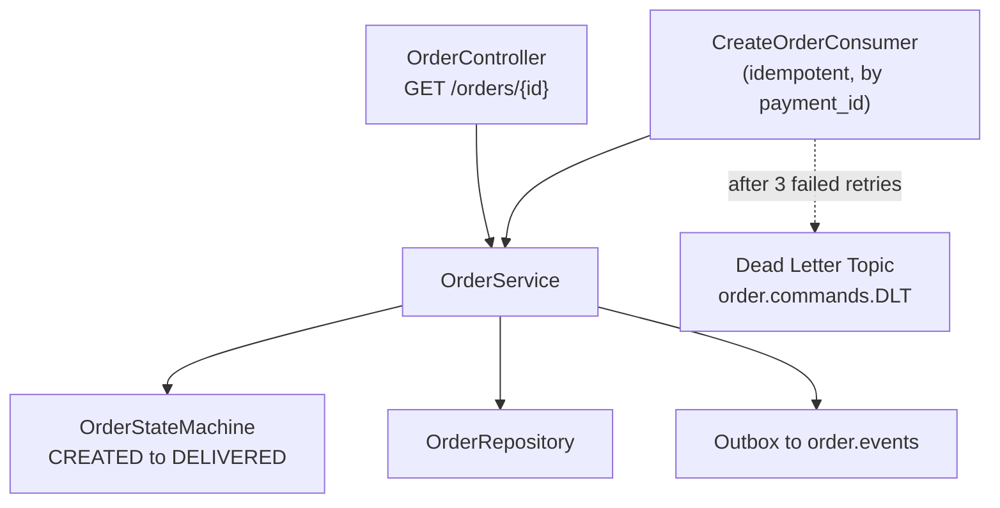
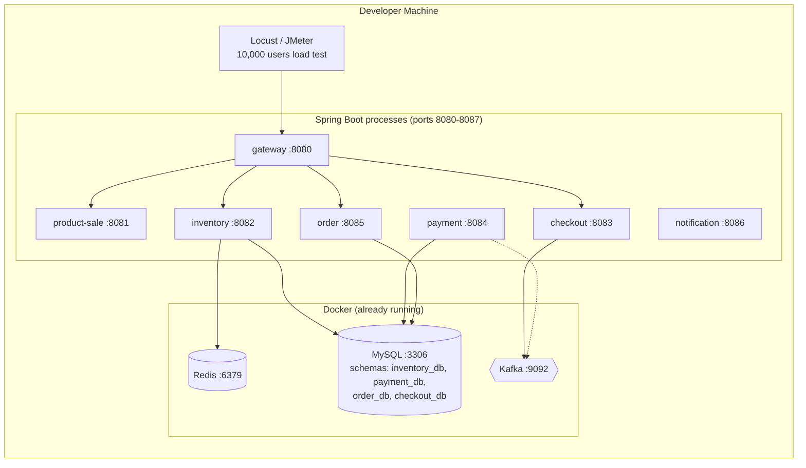
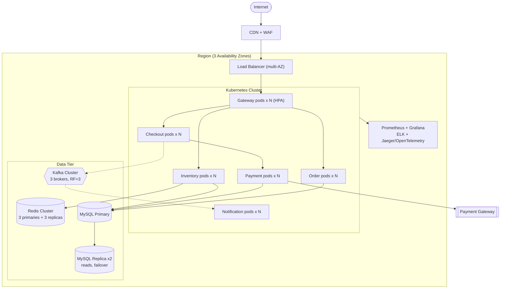
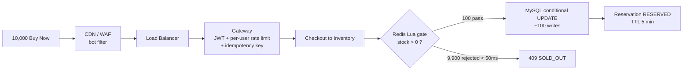

# SALESTORM – Stage 2: Architecture Design (HLD)

Legend used in all diagrams: **solid arrow = synchronous call**, **dotted arrow = asynchronous (Kafka event/command)**.

---

## 1. System Context Diagram

**Reading it:** SALESTORM is one black box with 2 human actors and 4 external systems. Payment Gateway and Delivery Partner are the unreliable ones, so they are always accessed through an Adapter plus Circuit Breaker.

---

## 2. Container / Service Architecture

### Service responsibilities (one owner per concept)

| Service | Owns | Does NOT do |
|---|---|---|
| Product / Sale | Catalogue, sale window, price rules | Stock counts |
| Cart | Cart and cart items | Reservation |
| Inventory-Reservation | `inventory`, `inventory_reservation`; the only writer of stock | Payment, orders |
| Checkout | Saga state, pricing/coupon application, orchestration | Persisting stock or orders |
| Payment | `payment`, idempotency, gateway calls, reconciliation | Order creation |
| Order | `orders`, `order_item`, order state machine | Charging money |
| Notification / Shipment | Messages, shipment, tracking | Any business decision |

---

## 3. Component Diagrams (critical services)

### 3.1 Inventory-Reservation Service

### 3.2 Checkout Service (Saga orchestrator)

### 3.3 Payment Service

### 3.4 Order Service

---

## 4. Deployment Diagrams

### 4.1 Local / Hackathon demo (Docker)

### 4.2 Production reference (what we defend in the jury)

---

## 5. Synchronous vs Asynchronous Communication

| Interaction | Mode | Why |
|---|---|---|
| Client to Gateway to Checkout `POST /buy` | **Sync** | Customer needs an immediate yes/no (reserved or sold out) |
| Checkout to Inventory `reserve` | **Sync** | Result decides the response; must be authoritative and fast (Redis gate) |
| Checkout to Payment `initiate` | **Sync** | Customer waits on the payment page; gateway call has a 3 s timeout |
| Payment to external gateway | **Sync with timeout, retry, breaker** | Protocol is request/response; failure is contained by Resilience4j |
| Payment result to Checkout | **Async** `payment.events` | Decouples payment latency and failures from checkout threads |
| Checkout to Order `CreateOrder` | **Async** `order.commands` | Order Service may be down for 30 s; Kafka buffers, nothing is lost |
| Order to Inventory `order.confirmed` to mark SOLD | **Async** | Inventory confirmation is eventual; reservation stays safe until then |
| Reservation expiry/release to Redis counter re-credit | **Async/scheduled** | Background job, not on the customer path |
| Notification and Shipment | **Async** | Never block the purchase on email/SMS or courier |
| Product browsing | **Sync from cache** | Read-heavy, served from CDN/Redis |

**Rule of thumb:** anything the customer is waiting on and that must be decided now is sync; anything that can be retried later without the customer noticing is async.

### Kafka topics and event ownership

| Topic | Producer (owner) | Consumers | Key events |
|---|---|---|---|
| `inventory.events` | Inventory | Checkout, Notification | `ReservationCreated`, `ReservationExpired`, `ReservationReleased`, `StockConfirmed` |
| `payment.events` | Payment | Checkout, Notification | `PaymentSucceeded`, `PaymentFailed`, `PaymentTimedOut` |
| `order.commands` | Checkout | Order | `CreateOrder` |
| `order.events` | Order | Checkout, Inventory, Notification | `OrderCreated`, `OrderConfirmed`, `OrderShipped`, `OrderDelivered` |
| `*.DLT` | Kafka error handler | Ops / replay tool | Poison or repeatedly failing messages |

Partition key = `product_id` or `order_id`, so events for one entity stay ordered.

---

## 6. Request Path for 10,000 Concurrent Buy Requests

**Exact contention point:** the single Redis Lua script per product (atomic, single-threaded execution) is where 10,000 requests are serialised cheaply. MySQL only sees about 100 writes, protected by `WHERE available_quantity > 0` plus a `CHECK (available_quantity >= 0)` constraint as the last line of defence.

---

## 7. Bottlenecks and Mitigations

| # | Likely bottleneck | Why it happens | Mitigation |
|---|---|---|---|
| 1 | **Hot Redis key** (one product's stock counter) | All 10,000 requests hit one key | Lua script is O(1) and about 100k ops/s per node; shard by `product_id` for multi-product sales; local pre-check "sold-out flag" at gateway to short-circuit |
| 2 | **MySQL inventory row lock** | Many writers on one row | Redis gate means only about 100 writes reach it; short transactions; never hold a lock across a network call |
| 3 | **Payment gateway latency / outage** | External, slow, rate-limited | Timeout 3 s, retry with backoff, circuit breaker, bulkhead thread pool, reconciliation job |
| 4 | **Kafka consumer lag** | Order Service slow or down | Partition count above consumer count, consumer autoscaling, DLQ, lag alert above 10 s |
| 5 | **API Gateway / LB at 500k rps** | Raw connection volume | CDN absorbs static content, WAF drops bots, autoscale gateway pods, per-IP and per-user limits, queue-style "waiting room" if needed |
| 6 | **DB connection pool exhaustion** | Many pods, many threads | Pool sizing per pod, PgBouncer-like proxy (ProxySQL), fail fast with timeouts |
| 7 | **Redis and MySQL drift** | Redis crash or lost script result | Reconciler job, MySQL constraint is the final truth, rebuild Redis counter from MySQL on restart |
| 8 | **Expiry release storm** | Many reservations expire together | Batch release with `LIMIT`, indexed `expires_at`, Redis sorted set as expiry queue |

**What changes at 50x traffic:** CDN, WAF and gateway scale out first; most of the extra load is rejected at the edge or by the Redis gate, so MySQL load barely changes. Redis moves to a cluster, Kafka partitions increase, and a virtual waiting room limits how many users enter checkout.

---

## 8. Why Each Major Component Exists

| Component | Why it exists | What breaks without it |
|---|---|---|
| **CDN + WAF** | Offloads static/product traffic, blocks bots and DDoS | Gateway and services drown under 500k rps |
| **Load Balancer** | Spreads traffic across gateway instances, health checks, failover | Single point of failure, uneven load |
| **API Gateway** | One entry for auth, rate limiting, routing, trace-id injection | Every service re-implements security and throttling |
| **Redis** | Atomic stock gate, idempotency keys, rate-limit counters, product cache | 10,000 requests hit MySQL directly, lock contention |
| **MySQL** | Durable, transactional source of truth with constraints | No guarantee against oversell after a Redis loss |
| **Kafka** | Durable async backbone for saga and events, buffers outages | Payment-success-but-order-failure loses orders; tight coupling |
| **Outbox table** | Makes "update DB" and "publish event" atomic | Event lost or published without the DB commit |
| **Inventory-Reservation Service** | Single writer of stock, owns reservation lifecycle | Overselling from multiple writers |
| **Checkout (Saga)** | Coordinates multi-service workflow and compensation | No owner for "what if step 3 fails" |
| **Payment Service + Adapter + Circuit Breaker** | Isolates unreliable gateway, enforces idempotent charging | Duplicate charges, cascading failures |
| **Order Service (state machine)** | Enforces valid order transitions, audit trail | Invalid states, no recovery path |
| **Notification/Shipment** | Reacts to events without blocking purchase | Slow email/SMS delays checkout |
| **Observability stack** | Metrics, logs, traces to detect inventory mismatch, lag, payment failures | Failures stay invisible until customers complain |

---

## 9. Trade-offs Introduced by This Architecture

- **Complexity vs correctness:** 7 services plus saga and outbox is harder to build than a monolith, but each strict guarantee has a clear owner. For the hackathon demo, services can share one MySQL instance with separate schemas.
- **Redis + MySQL dual state:** faster rejection, but drift risk; mitigated by reconciliation and the MySQL constraint.
- **Eventual consistency for orders:** a customer may see "payment received, confirming order" for up to about 60 s during an Order Service outage; no money or stock is lost.
- **Sync reserve path:** Inventory availability directly affects Buy Now availability, so Inventory gets the strictest scaling and monitoring.
