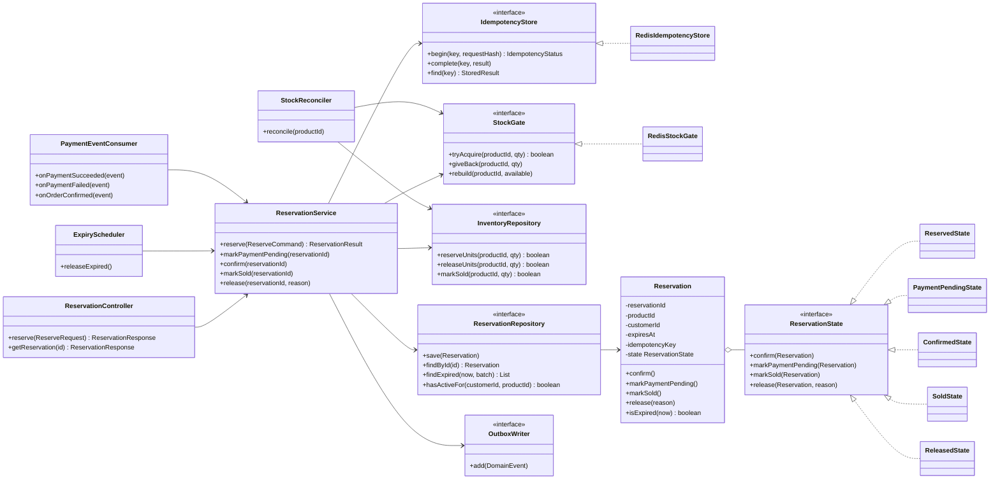
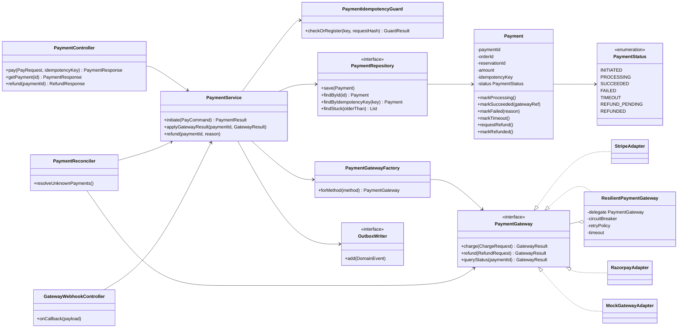
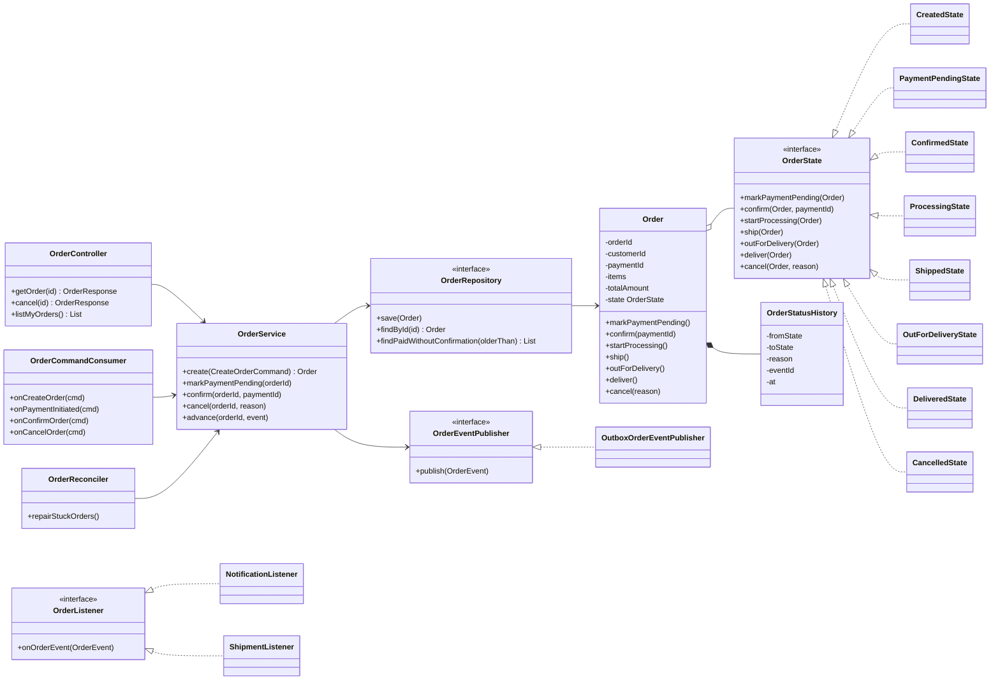
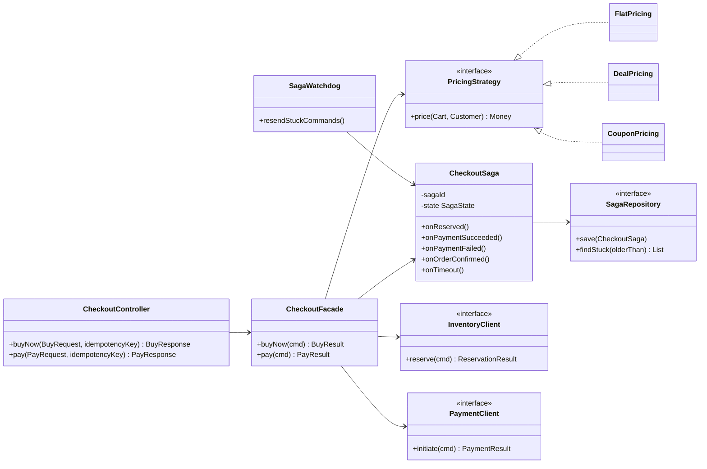
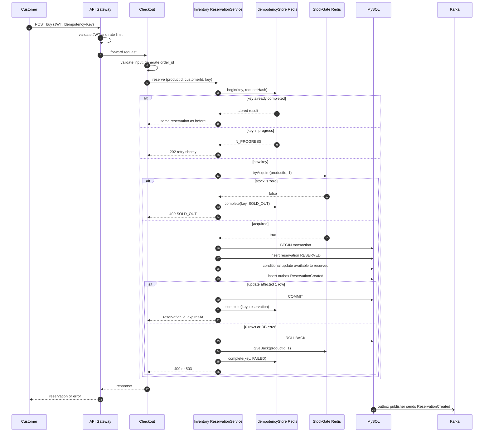
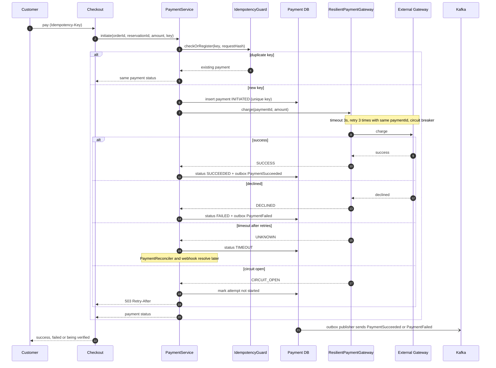
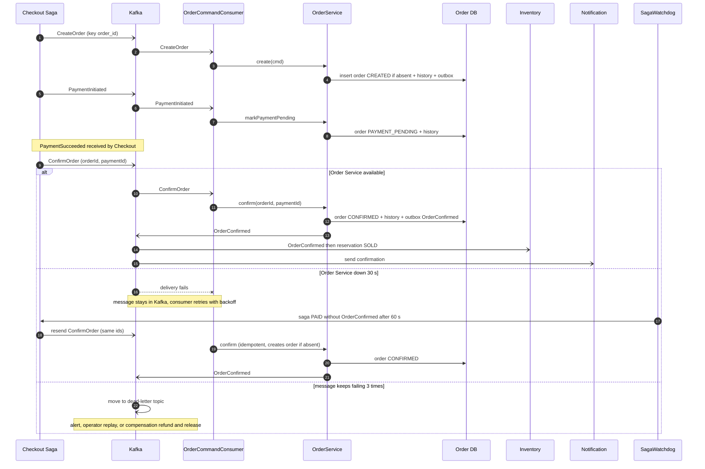
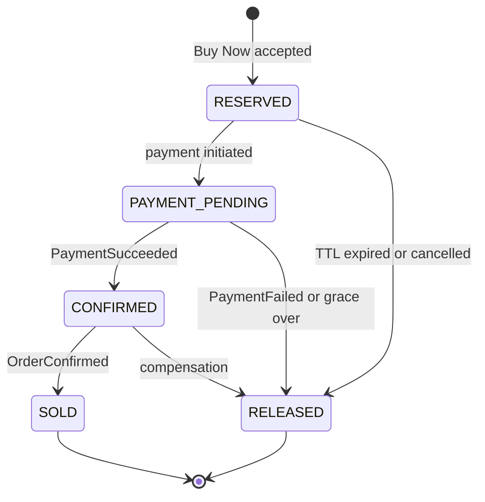
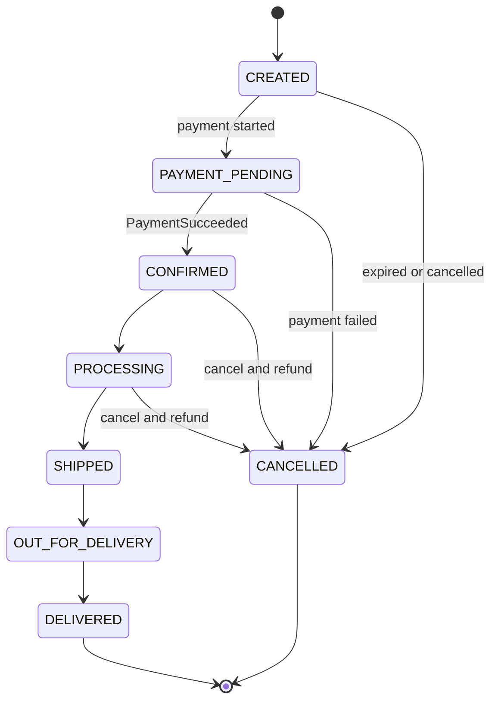

# SALESTORM – Stage 5: Low-Level Design (LLD)

**Critical modules selected:** Inventory-Reservation, Payment, Order (plus the Checkout Facade that coordinates them).
**Goal:** clear responsibilities, small interfaces, explicit state, and a clear home for validation, idempotency and error handling. Not a large codebase.

---

## 1. Service Boundaries and Domain Responsibilities

| Service | Domain responsibility (owns) | Must NOT do | Data it owns |
|---|---|---|---|
| **Inventory-Reservation** | Stock buckets, reservation lifecycle, expiry, oversell protection | Take payments, create orders, know price | `inventory`, `inventory_reservation`, `outbox` |
| **Payment** | Charging, refunds, payment state, payment idempotency, gateway isolation | Change stock or order state directly | `payment`, `refund`, `outbox` |
| **Order** | Order record, order state machine, order history, cancellation rules | Charge money, touch stock counters | `orders`, `order_item`, `order_status_history`, `outbox` |
| **Checkout** | Orchestrates the purchase saga, applies pricing/coupon, tracks saga progress | Persist stock, payments or orders itself | `checkout_saga`, `outbox` |
| **Notification / Shipment** | Messages and fulfilment tracking driven by events | Any purchase decision | `notification`, `shipment` |

**Why these boundaries are right (jury answer):** each service owns exactly one reason to change and one set of invariants. Stock correctness lives only in Inventory (single writer). Money correctness lives only in Payment. Lifecycle correctness lives only in Order. They talk through commands and events, so any one can fail or scale independently.

---

## 2. Class Diagrams

### 2.1 Inventory-Reservation module



**Responsibilities**
- `ReservationService` is the only class that coordinates gate, DB and outbox for stock changes.
- `StockGate` hides Redis; `InventoryRepository` hides MySQL (Repository + DIP). The service never mentions Redis or SQL.
- `Reservation` owns its legal transitions through `ReservationState` (State pattern), so invalid transitions cannot happen anywhere else in the code.
- `ExpiryScheduler`, `PaymentEventConsumer` and `StockReconciler` are **entry points** that call the same service methods, so there is one implementation of each business rule.

### 2.2 Payment module



**Responsibilities**
- `PaymentGateway` is the abstraction; each provider is an **Adapter** that converts our model to the provider API. A new provider means a new adapter class only.
- `ResilientPaymentGateway` is a **decorator/proxy** adding timeout, retry and circuit breaker around any gateway, so resilience is written once.
- `PaymentService` does not know which provider is used; it asks the factory.
- Webhook and reconciler both feed the same `applyGatewayResult`, which is idempotent.

### 2.3 Order module



**Responsibilities**
- `Order` delegates every transition to its `OrderState`; an illegal call (for example `ship()` on `CreatedState`) throws an invalid-transition error. All transition rules sit in one place.
- Every successful transition appends an `OrderStatusHistory` row in the same transaction.
- `OrderEventPublisher` + `OrderListener` give an **Observer** style fan-out (notification, shipment) without `OrderService` knowing the listeners. Across services, the implementation is the outbox plus Kafka.

### 2.4 Checkout Facade (coordination, kept thin)



---

## 3. Sequence Diagrams

### 3.1 Purchase / Reservation



### 3.2 Payment



### 3.3 Order creation, confirmation and recovery



---

## 4. State Diagrams

### 4.1 Reservation lifecycle



### 4.2 Order lifecycle



---

## 5. Where Validation, Idempotency and Error Handling Belong

### 5.1 Validation (each layer checks only what it owns)

| Layer | Validates | Example |
|---|---|---|
| **API Gateway** | Authentication, rate limit, request size, required headers | Missing JWT → 401; more than 5 buys/min per user → 429; missing `Idempotency-Key` → 400 |
| **Controller (DTO)** | Shape and format of input | Quantity must be 1 to the per-user limit; IDs well-formed |
| **Application service** | Business preconditions | Sale is active, customer has no active reservation, amount equals the priced total |
| **Domain entity / State** | Legal state transitions, invariants | `ship()` on a CREATED order is rejected; releasing a SOLD reservation is rejected |
| **Database** | Last-line integrity | Unique idempotency key, non-negative quantities, foreign keys |

Principle: **never trust the previous layer for integrity**. The DB constraints stay even though services validate.

### 5.2 Idempotency (per operation)

| Operation | Where | Key | Mechanism |
|---|---|---|---|
| Buy Now / reserve | `ReservationService` via `IdempotencyStore` | `Idempotency-Key` header | Redis set-if-absent with stored result, plus DB unique key |
| One active reservation per customer | Reservation repository | customer + product | DB unique rule on active rows |
| Initiate payment | `PaymentIdempotencyGuard` | Idempotency-Key (derived from reservation id) | Unique key in Payment DB, request-hash check |
| Gateway charge | `ResilientPaymentGateway` / adapter | `payment_id` as merchant reference | Gateway-side idempotency, safe retries |
| Refund | `PaymentService` | `payment_id` + refund reason | Unique refund reference |
| Kafka consumers (confirm, release, order commands) | Consumer + service | `event_id` / `payment_id` / `order_id` | Processed-events check and monotonic state transitions |
| Order creation / confirm | `OrderService` | `order_id` (create if absent) | Primary key, state machine ignores repeats |

### 5.3 Error handling

| Error type | Where handled | Response |
|---|---|---|
| Validation error | Controller advice | 400 with error code |
| Unauthorized / forbidden | Gateway | 401 / 403 |
| Rate limited | Gateway | 429 with `Retry-After` |
| Sold out | `ReservationService` | 409 `SOLD_OUT` (or `TEMPORARILY_UNAVAILABLE`) |
| Idempotency conflict (same key, different payload) | Idempotency layer | 422 / 409 |
| Duplicate in progress | Idempotency layer | 202 with retry hint |
| Invalid state transition | Domain `State` objects | Domain exception → 409 `INVALID_STATE` |
| Payment declined | `PaymentService` | Business outcome FAILED (not an exception), event published |
| Gateway timeout / 5xx | `ResilientPaymentGateway` | Retry, then TIMEOUT state, reconcile |
| Circuit open | `ResilientPaymentGateway` | Fail fast, 503 `Retry-After`, reservation kept |
| Database / Redis down | Service boundary | 503; compensate Redis counter; client retries with same key |
| Poison message | Kafka consumer error handler | 3 retries then dead-letter topic and alert |

**Exception model:** a small hierarchy: `BusinessRuleException` (sold out, invalid state, conflict) maps to 4xx and is never retried; `TransientException` (timeout, connection) maps to 5xx and is retried with the same idempotency key; `FatalException` (programming or data corruption) alerts and goes to the dead-letter topic. A single global exception handler per service converts these to the standard error body (code, message, trace id).

---

## 6. Package Layout per Service (Spring Boot guidance, no code)

```
com.salestorm.inventory
 ├─ api            controllers, request/response DTOs, exception advice
 ├─ application    ReservationService, schedulers, event consumers
 ├─ domain         Reservation, ReservationState + concrete states, domain events, repository interfaces, StockGate interface
 ├─ infrastructure JPA repositories, RedisStockGate, RedisIdempotencyStore, outbox publisher, Kafka config
 └─ config
```

Rule: **`domain` depends on nothing; `application` depends on `domain`; `infrastructure` implements `domain` interfaces.** This is Dependency Inversion in practice and lets tests replace Redis or the gateway with fakes. Payment and Order follow the same layout.

---

## 7. How the LLD Answers the Jury's Questions

| Question | Where in this LLD |
|---|---|
| Why is this the correct service boundary? | Section 1: one owner per invariant (stock, money, lifecycle) |
| Where exactly is inventory consistency guaranteed? | `InventoryRepository` conditional update inside the reservation transaction (sequence 3.1) |
| What if two requests hit Inventory at once? | `StockGate` serialises; DB conditional update arbitrates |
| Why sync here, async there? | Reserve and initiate payment are sync (customer waits); order, inventory confirmation and notifications are commands/events |
| Payment success but Order fails? | Sequence 3.3: Kafka durability, idempotent consumer, watchdog, reconciler, DLQ, compensation |
| How easy is adding a payment provider? | New `PaymentGateway` adapter plus factory registration; `PaymentService` unchanged |
