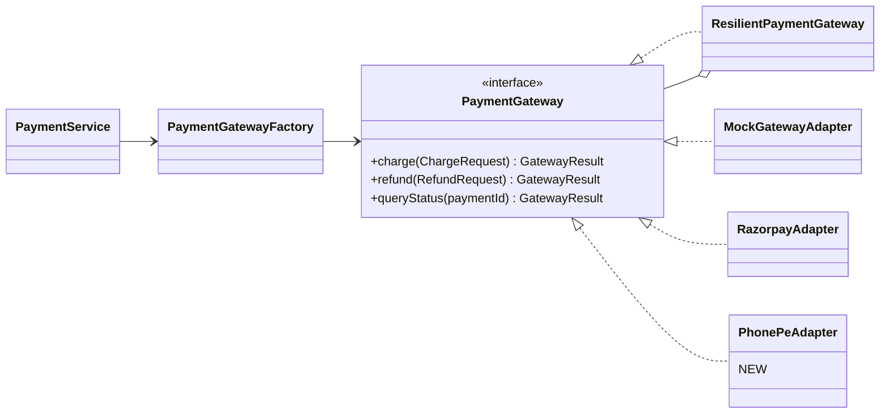
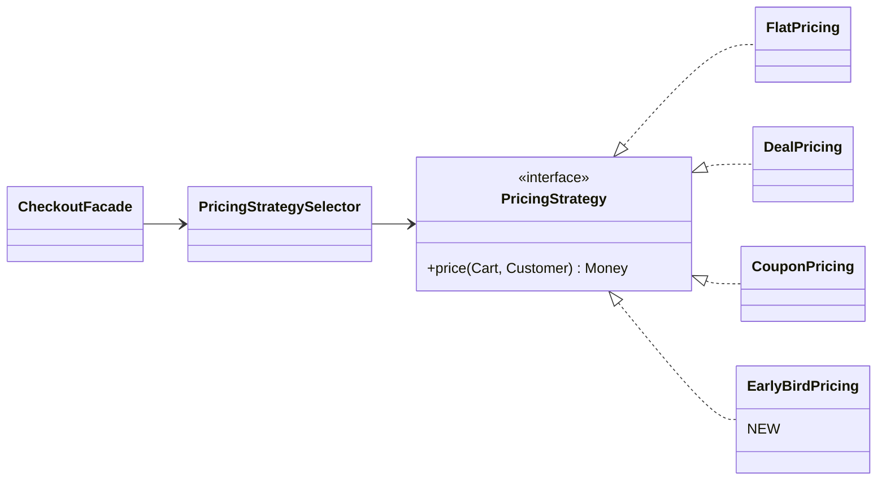
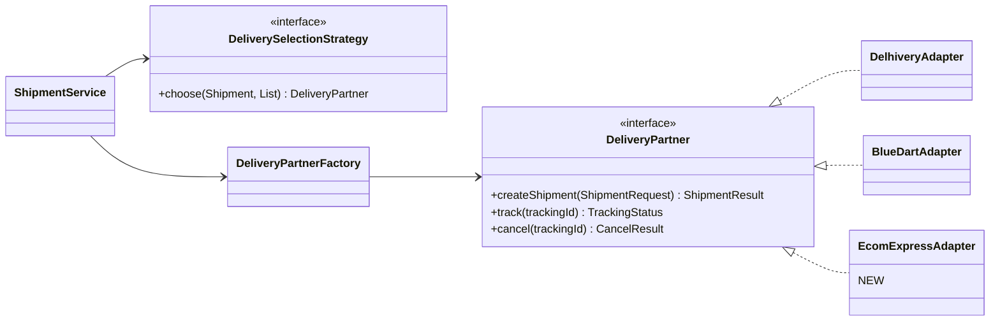

# SALESTORM – Stage 6B: Design Patterns and Extensibility

Patterns are used only where they solve a real problem in this system. Each entry states **the problem, where it lives, and the trade-off it introduces.**

---

## 1. Pattern Map (summary)

| Pattern | Where used | Module |
|---|---|---|
| Strategy | `PricingStrategy`, `DeliverySelectionStrategy`, payment method selection | Checkout, Shipment, Payment |
| Factory | `PaymentGatewayFactory`, `DeliveryPartnerFactory` | Payment, Shipment |
| State | `ReservationState`, `OrderState` | Inventory, Order |
| Observer | `OrderListener` (`NotificationListener`, `ShipmentListener`) | Order |
| Adapter | `MockGatewayAdapter`, `RazorpayAdapter`, courier adapters | Payment, Shipment |
| Facade | `CheckoutFacade` | Checkout |
| Repository | `InventoryRepository`, `ReservationRepository`, `PaymentRepository`, `OrderRepository` | All |
| Circuit Breaker | `ResilientPaymentGateway` | Payment |
| Decorator (supporting) | `ResilientPaymentGateway` wraps any gateway | Payment |
| Outbox (architectural) | `OutboxWriter` + publisher | All services |
| Saga (architectural) | `CheckoutSaga` | Checkout |

---

## 2. Pattern Details: Problem Solved and Trade-off

### 2.1 Strategy
- **Where:** `PricingStrategy` (`FlatPricing`, `DealPricing`, `CouponPricing`); `DeliverySelectionStrategy` (cheapest, fastest, nearest); payment method selection.
- **Problem solved:** pricing and selection rules change often (new deal, new coupon). Without Strategy, `CheckoutFacade` becomes a long conditional chain that is edited for every campaign.
- **How it works:** the sale configuration says which pricing type applies; the facade asks a selector for the matching strategy and calls one method.
- **Trade-off:** more small classes and a selection step; the rule for choosing the strategy must itself be maintained (data-driven in the sale table). Overkill for a single fixed price, so we keep it only where variation is real.

### 2.2 Factory
- **Where:** `PaymentGatewayFactory`, `DeliveryPartnerFactory`.
- **Problem solved:** `PaymentService` should not know how to build or choose a provider (credentials, endpoints, wrapping in the resilience decorator). The factory returns a ready, resilience-wrapped `PaymentGateway` for a payment method or tenant.
- **Trade-off:** one more indirection and a registry to keep in sync with configured providers. In Spring Boot the registry is simply the set of provider beans keyed by name, so maintenance cost is low.

### 2.3 State
- **Where:** `ReservationState` (Reserved, PaymentPending, Confirmed, Sold, Released) and `OrderState` (Created ... Delivered, Cancelled).
- **Problem solved:** lifecycle rules (for example "no cancel after SHIPPED", "CONFIRMED reservation is never expired") would otherwise be scattered across services as `if status == ...` checks, and one missed check causes oversell or an invalid order. State puts every legal transition in one place and rejects the rest with a single error.
- **Trade-off:** many small classes, and the interface grows with every new action. Transitions are also checked in the database (conditional status update) because an in-memory State object alone cannot stop two concurrent workers; State gives clarity, the DB gives safety.

### 2.3b Why both State and a conditional DB update
State objects decide *whether a transition is legal*. The conditional update `status = expected` decides *who wins a race*. Both are needed.

### 2.4 Observer
- **Where:** `OrderEventPublisher` and `OrderListener` implementations; across services realised by outbox + Kafka topics.
- **Problem solved:** when an order changes state, notification, shipment and inventory must react. If `OrderService` called each of them directly, it would be coupled to all of them and a slow email provider would slow order processing.
- **Trade-off:** reactions are asynchronous and eventually consistent; flow is harder to trace (mitigated by trace ids and event ids); listeners must be idempotent because delivery is at-least-once.

### 2.5 Adapter
- **Where:** `MockGatewayAdapter`, `RazorpayAdapter`, `StripeAdapter`; courier adapters (`DelhiveryAdapter`, `BlueDartAdapter`).
- **Problem solved:** every provider has its own request format, status codes and error behaviour. Adapters translate them to our `PaymentGateway` / `DeliveryPartner` contract and map provider quirks to the agreed outcomes (SUCCESS, DECLINED, UNKNOWN).
- **Trade-off:** mapping code per provider and the risk of losing provider-specific features; mitigated by contract tests and an extensible result model.

### 2.6 Facade
- **Where:** `CheckoutFacade`.
- **Problem solved:** the client (and controller) should see two simple operations, buy and pay, instead of sequencing inventory, pricing, payment and saga calls itself.
- **Trade-off:** risk of the facade becoming a "god class". We prevent that by keeping it thin: it only sequences calls, while rules stay in the services and `CheckoutSaga` holds progress and compensation.

### 2.7 Repository
- **Where:** `InventoryRepository`, `ReservationRepository`, `PaymentRepository`, `OrderRepository`.
- **Problem solved:** domain code needs "reserve one unit if available" or "find expired reservations" without SQL, locks or JPA details. Repositories expose business-shaped operations and hide the conditional-update technique.
- **Trade-off:** an abstraction layer over JPA (some duplication of simple queries) and the risk of leaking persistence concerns if methods are named after tables rather than business actions. Critical operations (conditional update) stay as explicit repository methods so they cannot be bypassed.

### 2.8 Circuit Breaker (with Decorator)
- **Where:** `ResilientPaymentGateway` wraps any `PaymentGateway`.
- **Problem solved:** a slow or failing gateway would hold threads, exhaust the pool and drag down unrelated endpoints. The breaker opens after 50% failures over 10 calls, fails fast for 30 s, then probes with 3 calls. Timeout, retry (same `paymentId`) and bulkhead are applied in the same wrapper.
- **Trade-off:** while open, genuine customers are rejected even if the gateway partly works; thresholds need tuning; fail-fast responses must be handled by the UI (retry within the reservation TTL). Decorator keeps this logic out of every adapter.

### 2.9 Outbox (architectural pattern)
- **Problem solved:** "save to DB" and "publish event" must both happen or neither. The event row is written in the same transaction as the state change; a publisher sends it to Kafka afterwards.
- **Trade-off:** slight delay, extra table and publisher job, at-least-once delivery so consumers must be idempotent.

### 2.10 Saga (architectural pattern)
- **Problem solved:** a purchase spans inventory, payment and order, each with its own database. A saga coordinates steps and defines compensation (release stock, refund) instead of a distributed transaction.
- **Trade-off:** eventual consistency, compensation logic to design and test, and a watchdog for stuck sagas. Orchestration (in Checkout) was chosen over choreography because the purchase flow is short and the jury needs one place to explain "what happens if step N fails".

---

## 3. Patterns Considered and Not Used

| Pattern | Why not |
|---|---|
| Singleton | Spring beans already give single instances; hand-written singletons hurt testing |
| Abstract Factory | Only one product family per factory is needed; plain Factory is enough |
| Chain of Responsibility for validation | Layered validation (gateway, controller, service, domain, DB) is clearer here |
| Event sourcing | Audit history table is sufficient; event sourcing would add major complexity for a hackathon timeline |

Keeping this list shows engineering judgement: patterns are tools, not decoration.

---

## 4. Accommodating Change with Minimal Modification

### 4.1 Add a new payment provider (for example "PhonePe")

| Step | Action |
|---|---|
| 1 | Create `PhonePeAdapter` implementing `PaymentGateway`; map PhonePe statuses to SUCCESS / DECLINED / UNKNOWN / NOT_FOUND |
| 2 | Pass the shared **contract test suite** (idempotent charge, decline does not throw, timeout means UNKNOWN) |
| 3 | Register the adapter as a provider and add its credentials via secrets management and configuration |
| 4 | Enable it for a payment method or a percentage of traffic (feature flag) |

| | Classes |
|---|---|
| **New** | `PhonePeAdapter` (and its config) |
| **Modified** | Only the registration/config |
| **Unchanged** | `PaymentService`, `Payment`, `PaymentStatus`, `ResilientPaymentGateway`, reconciler, controllers, database schema, events |

### 4.2 Add a new pricing strategy (for example "Early-Bird 20% for first 50 buyers")

| Step | Action |
|---|---|
| 1 | Create `EarlyBirdPricing` implementing `PricingStrategy` |
| 2 | Add the strategy type to sale configuration data (`pricing_type = EARLY_BIRD`, with threshold and percentage) |
| 3 | Test: price never negative, same currency, deterministic for the same input |

| | Classes |
|---|---|
| **New** | `EarlyBirdPricing` |
| **Modified** | Sale configuration data only |
| **Unchanged** | `CheckoutFacade`, `ReservationService`, `PaymentService`, `OrderService` |

**Important rule:** the price is calculated once at checkout and stored on the order and payment request; the payment service validates `amount == priced total` rather than recalculating, so a pricing change cannot cause a payment mismatch.

### 4.3 Add a new delivery partner (for example "Ecom Express")

| Step | Action |
|---|---|
| 1 | Create `EcomExpressAdapter` implementing `DeliveryPartner`; map its tracking statuses to our statuses (PROCESSING, SHIPPED, OUT_FOR_DELIVERY, DELIVERED) |
| 2 | Pass the delivery contract tests |
| 3 | Register it and add credentials; update selection data (coverage pin codes, cost, SLA) |
| 4 | Tracking updates enter as events (`ShipmentStatusChanged`), so `Order` moves through its existing states |

| | Classes |
|---|---|
| **New** | `EcomExpressAdapter` |
| **Modified** | Registration/config, partner coverage data |
| **Unchanged** | `ShipmentService`, `Order`, `OrderState` classes, notification logic |

### 4.4 Change-impact summary

| Change request | New classes | Edits to core logic |
|---|---|---|
| New payment provider | 1 adapter | None |
| New pricing rule | 1 strategy | None |
| New delivery partner | 1 adapter | None |
| New order state (RETURNED) | 1 state class | Allowed-transition lines in the previous state class only |
| New notification channel | 1 channel class | None |
| Replace Redis gate | 1 `StockGate` implementation | None |

---

## 5. Trade-off Summary (what the pattern-heavy design costs)

| Cost | Why we accept it | How it is limited |
|---|---|---|
| More classes and indirection | Core flows (payment, inventory) must stay stable while the edges change often | Patterns only at real variation points; thin facade |
| Eventual consistency from Observer / Saga / Outbox | Prevents losing payments when a service is down | Reconcilers and watchdog; clear customer status messages |
| State objects plus DB conditional updates (two checks) | One explains legality, the other wins concurrent races | Both are small and tested together |
| Contract-test discipline for adapters | Makes Liskov substitution real | One shared suite per interface |
| Hackathon time | Full pattern set is too large to code in 7 hours | For the demo, implement Strategy (payment, pricing), State (reservation, order), Adapter (mock gateway), Repository and Circuit Breaker; keep Observer and Facade as thin classes; the rest are defended in design |
