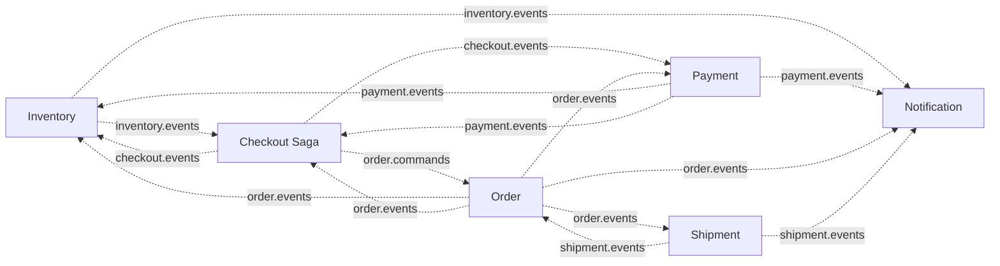

# SALESTORM – Stage 7B: Event and Message Design

## 1. Commands vs Events

| | **Command** | **Event** |
|---|---|---|
| Meaning | "Please do this" | "This already happened" |
| Naming | Imperative: `CreateOrder` | Past tense: `PaymentSucceeded` |
| Consumers | Exactly one owner (the handler) | Zero or many |
| Owned by | The **consumer** (it defines the contract) | The **producer** |
| Can be rejected? | Yes | No, it is a fact |
| Used for | Direct orchestration by the Checkout saga | Broadcasting state changes |

**Ownership rule:** only the owning service may publish its events. No service writes to another service's topic, and no service reads another service's database.

---

## 2. Topic Catalogue

| Topic | Type | Producer (owner) | Consumers | Partition key |
|---|---|---|---|---|
| `inventory.events` | Events | Inventory-Reservation | Checkout, Notification, Product/Sale (stock flag) | `orderId` (stock-level events use `productId`) |
| `payment.events` | Events | Payment | Inventory, Checkout, Notification | `orderId` |
| `checkout.events` | Events | Checkout | Inventory, Payment, Notification, Analytics | `orderId` |
| `order.commands` | Commands | Checkout | Order | `orderId` |
| `order.events` | Events | Order | Inventory, Checkout, Payment, Shipment, Notification | `orderId` |
| `shipment.events` | Events | Shipment | Order, Notification | `orderId` |
| `<topic>.DLT` | Dead letters | Kafka error handler | Operations tooling | same as source |

*Update to Stage 2 table:* `checkout.events` and `shipment.events` are added so compensation and delivery tracking each have a clear owner.

**Why `orderId` as the partition key:** every reservation, payment and order event for one purchase carries the same `orderId`, so all events of one purchase are **ordered** within a partition, while different purchases spread across partitions for parallelism.



---

## 3. Message Envelope (every command and event)

| Field | Purpose |
|---|---|
| `eventId` | Unique id (UUID); the **idempotency key** for consumers |
| `type` | For example `PaymentSucceeded` |
| `version` | Schema version (integer) |
| `occurredAt` | UTC timestamp |
| `producer` | Owning service name |
| `aggregateType`, `aggregateId` | For example `Payment`, `PAY-77ab` |
| `orderId` | Correlation id for the purchase (also the partition key) |
| `traceId` | Distributed tracing id carried from the original request |
| `causationId` | `eventId` of the message that caused this one |
| `payload` | Event-specific data |

Example:
```json
{
  "eventId": "e1b7c0f2-5d6a-4c1e-9a77-0c2d1f4a9b10",
  "type": "PaymentSucceeded",
  "version": 1,
  "occurredAt": "2026-10-05T10:16:03Z",
  "producer": "payment-service",
  "aggregateType": "Payment",
  "aggregateId": "PAY-77ab",
  "orderId": "ORD-8f3a",
  "traceId": "4bf92f3577b34da6a3ce929d0e0e4736",
  "causationId": "c9a1...",
  "payload": {
    "paymentId": "PAY-77ab",
    "reservationId": "RSV-41c2",
    "customerId": "C-501",
    "amount": 4499.00,
    "currency": "INR"
  }
}
```
Payloads carry **identifiers and facts needed by consumers**, never card data or other sensitive information.

---

## 4. Commands (owned by the consuming service)

| Command | Topic | Sent by | Handled by | Effect | Idempotency |
|---|---|---|---|---|---|
| `CreateOrder` | `order.commands` | Checkout (at Buy Now) | Order | Create order in CREATED with items and price | Create if absent by `orderId` |
| `MarkOrderPaymentPending` | `order.commands` | Checkout (after `PaymentInitiated`) | Order | CREATED → PAYMENT_PENDING | Ignore if already at or beyond that state |
| `ConfirmOrder` | `order.commands` | Checkout (after `PaymentSucceeded`) | Order | PAYMENT_PENDING → CONFIRMED; creates the order first if it does not exist (carries full order data) | By `orderId` + `paymentId`; repeat ignored |
| `CancelOrder` | `order.commands` | Checkout (payment failed, reservation expired) | Order | → CANCELLED with reason | Already CANCELLED returns no change |

(The Stage 5 handler names `onCreateOrder`, `onPaymentInitiated`, `onConfirmOrder`, `onCancelOrder` correspond to these commands.)

Direct synchronous calls (reserve, initiate payment) remain REST between services because the caller needs the answer immediately.

---

## 5. Event Catalogue

### 5.1 `inventory.events` (owner: Inventory-Reservation)

| Event | Emitted when | Key payload | Consumers and reaction |
|---|---|---|---|
| `ReservationCreated` | Reservation committed | reservationId, orderId, productId, customerId, expiresAt | Checkout: saga → RESERVED; Notification: optional "item reserved" message |
| `ReservationConfirmed` | After `PaymentSucceeded` applied | reservationId, orderId | Checkout: informational (stock permanently held) |
| `ReservationSold` | After `OrderConfirmed` applied | reservationId, orderId | Checkout: saga → DONE |
| `ReservationReleased` | Expiry, payment failure, cancel, compensation | reservationId, orderId, **reason** (EXPIRED, PAYMENT_FAILED, CANCELLED, COMPENSATION) | Checkout: saga ends or compensates; Notification: "reservation expired" message |
| `ReservationConfirmationRejected` | Payment succeeded but reservation already released and re-reserve impossible (this is the "RefundRequired" case from Stage 4) | reservationId, orderId, paymentId | Payment: start refund; Checkout: saga → COMPENSATING; Notification: apology and refund notice |
| `StockLevelChanged` | Available count reaches or leaves zero | productId, available, reserved, sold | Product/Sale: update cached `SOLD_OUT` / `LOW_STOCK` flag |

### 5.2 `payment.events` (owner: Payment)

| Event | Emitted when | Key payload | Consumers and reaction |
|---|---|---|---|
| `PaymentInitiated` | Payment record created | paymentId, orderId, reservationId, amount | Inventory: reservation → PAYMENT_PENDING; Checkout: sends `MarkOrderPaymentPending` |
| `PaymentSucceeded` | Gateway success (or reconciled success) | paymentId, orderId, reservationId, customerId, amount | Inventory: reservation → CONFIRMED; Checkout: sends `ConfirmOrder`; Notification: "payment received" |
| `PaymentFailed` | Gateway decline or reconciled failure | paymentId, orderId, reservationId, reason | Inventory: release (PAYMENT_FAILED); Checkout: sends `CancelOrder`; Notification: "payment failed" |
| `PaymentTimedOut` | Outcome unknown after retries | paymentId, orderId | Inventory: extend hold (grace period); Notification: "being verified" |
| `PaymentRefunded` | Refund confirmed | paymentId, refundId, amount | Notification: refund message |
| `PaymentRefundFailed` | Refund cannot be completed | paymentId, refundId, reason | Alerting and manual follow-up |

### 5.3 `checkout.events` (owner: Checkout)

| Event | Emitted when | Key payload | Consumers and reaction |
|---|---|---|---|
| `CheckoutCompleted` | Saga reached DONE | orderId | Analytics (conversion metric), Notification |
| `CheckoutFailed` | Saga cannot finish (order can never be created, permanent failure) | orderId, reservationId, paymentId (if any), **reason**, refundRequired | Inventory: release reservation; Payment: refund if paid; Notification: failure message |

### 5.4 `order.events` (owner: Order)

| Event | Emitted when | Key payload | Consumers and reaction |
|---|---|---|---|
| `OrderCreated` | Order saved in CREATED | orderId, customerId, items, total | Notification (optional), Analytics |
| `OrderConfirmed` | → CONFIRMED | orderId, paymentId, items | Inventory: reservation → SOLD; Checkout: saga → DONE; Shipment: create shipment; Notification: "order confirmed" |
| `OrderCancelled` | → CANCELLED | orderId, reason, paymentId (if any) | Inventory: release (if CONFIRMED or SOLD, stock returns); Payment: refund if payment SUCCEEDED; Shipment: cancel; Notification |
| `OrderStatusChanged` | PROCESSING, SHIPPED, OUT_FOR_DELIVERY, DELIVERED | orderId, from, to | Notification, tracking views |

### 5.5 `shipment.events` (owner: Shipment)

| Event | Emitted when | Key payload | Consumers and reaction |
|---|---|---|---|
| `ShipmentCreated` | Partner booking made | shipmentId, orderId, partner, trackingId | Order: → PROCESSING; Notification |
| `ShipmentStatusChanged` | Partner update | shipmentId, orderId, status (SHIPPED, OUT_FOR_DELIVERY, DELIVERED) | Order: advance state; Notification |
| `ShipmentFailed` | Booking or delivery failed | shipmentId, orderId, reason | Order/ops: alert, retry with another partner |

---

## 6. Consumer Responsibility Matrix

| Consumer | Consumes | Responsible for | Must NOT do |
|---|---|---|---|
| **Inventory** | `PaymentInitiated`, `PaymentSucceeded`, `PaymentFailed`, `PaymentTimedOut`, `OrderConfirmed`, `OrderCancelled`, `CheckoutFailed` | Moving the reservation through its state machine and stock buckets; emitting inventory events | Create orders or refund money |
| **Payment** | `ReservationConfirmationRejected`, `OrderCancelled`, `CheckoutFailed` | Refunding exactly once | Change reservation or order state |
| **Checkout** | `ReservationCreated`, `ReservationSold`, `ReservationReleased`, `ReservationConfirmationRejected`, `PaymentInitiated`, `PaymentSucceeded`, `PaymentFailed`, `OrderConfirmed` | Advancing saga state, sending order commands, deciding compensation | Own business data of other services |
| **Order** | `order.commands`, `ShipmentCreated`, `ShipmentStatusChanged` | Valid order transitions and history | Charge money or modify stock |
| **Shipment** | `OrderConfirmed`, `OrderCancelled` | Booking and cancelling courier shipments | Order decisions |
| **Notification** | Most events | Sending messages, deduplicated by `eventId` | Any business decision; failures never block the purchase |
| **Product/Sale** | `StockLevelChanged` | Updating cached stock display flag | Stock accounting |

---

## 7. Delivery Guarantees and Reliable Messaging

| Concern | Design |
|---|---|
| **Producer side** | **Transactional outbox**: the event row is written in the same DB transaction as the state change; a publisher sends it to Kafka (idempotent producer, `acks=all`). No lost events, possible duplicates. |
| **Delivery semantics** | **At-least-once** end to end. |
| **Consumer side** | **Inbox / processed-events table**: consumer records `eventId` and applies the change in **one transaction**; a repeated event is detected by the unique `eventId` and skipped. Business-level idempotency (state machine, unique keys) is a second safeguard. |
| **Ordering** | Per `orderId` within a partition. State machines additionally ignore stale or earlier-state events (monotonic transitions), so a late event cannot move an order backwards. |
| **Out-of-order across topics** | Consumers tolerate it: `ConfirmOrder` carries enough data to create the order if `CreateOrder` has not arrived yet; Inventory's late `PaymentSucceeded` after release triggers re-reserve or `ReservationConfirmationRejected`. |
| **Retry policy** | 3 retries with exponential backoff (for example 1 s, 2 s, 4 s) for transient errors. |
| **Dead-letter handling** | After 3 failures, or immediately for non-retryable errors (invalid schema, validation failure), message goes to `<topic>.DLT` with error metadata; alert raised; operator replays through the admin tool after the fix. Replay is safe because consumers are idempotent. |
| **Poison messages** | Isolated in the DLT so a single bad message never blocks the partition. |
| **Retention** | 7 days on business topics, longer on DLTs, so replay and reconciliation remain possible. |
| **Schema evolution** | `version` field; only **additive, backward-compatible** changes within a version (new optional fields); breaking changes publish a new version and run both until consumers migrate. Schema registry (Avro or JSON Schema) recommended in production; plain JSON with documented schemas is acceptable for the demo. |
| **Security** | Topic ACLs: only the owner may write its topic; TLS in transit; no sensitive payment data in payloads; PII minimised. |

---

## 8. End-to-End Message Flow (happy path)

| # | Message | Producer → Consumer |
|---|---|---|
| 1 | `CreateOrder` | Checkout → Order |
| 2 | `ReservationCreated` | Inventory → Checkout |
| 3 | `PaymentInitiated` | Payment → Inventory, Checkout |
| 4 | `MarkOrderPaymentPending` | Checkout → Order |
| 5 | `PaymentSucceeded` | Payment → Inventory (CONFIRMED), Checkout |
| 6 | `ConfirmOrder` | Checkout → Order |
| 7 | `OrderConfirmed` | Order → Inventory (SOLD), Checkout (DONE), Shipment, Notification |
| 8 | `ReservationSold` | Inventory → Checkout |
| 9 | `ShipmentCreated`, `ShipmentStatusChanged` | Shipment → Order (state), Notification |
| 10 | `CheckoutCompleted` | Checkout → Analytics |

### Failure variants

| Scenario | Messages |
|---|---|
| Payment declined | `PaymentFailed` → Inventory releases (`ReservationReleased`: PAYMENT_FAILED) and Checkout sends `CancelOrder` → Order CANCELLED |
| Reservation expires unpaid | `ReservationReleased`: EXPIRED → Checkout sends `CancelOrder` |
| Order Service down 30 s | `ConfirmOrder` waits in `order.commands`; consumer catches up; saga watchdog re-sends after 60 s if needed (same ids, idempotent) |
| Payment succeeded after the hold was lost and stock is gone | `ReservationConfirmationRejected` → Payment refunds → `PaymentRefunded` |
| Order can never be created | `CheckoutFailed` (refundRequired) → Inventory releases, Payment refunds |
| Customer cancels a confirmed order | `OrderCancelled` → Payment refunds, Inventory returns stock, Shipment cancels |

---

## 9. Observability for Events

| Item | Detail |
|---|---|
| Tracing | `traceId` copied from the original HTTP request into every command and event; consumers continue the trace |
| Structured log per message | `eventId`, `type`, `orderId`, `traceId`, outcome (processed, skipped duplicate, retried, dead-lettered) |
| Metrics | Consumer lag per topic, retry rate, DLT size, outbox backlog (unpublished rows), processing latency |
| Alerts | Lag above 10 s, any growth of a DLT, outbox backlog above threshold, `PaymentSucceeded` without `OrderConfirmed` after 60 s |
