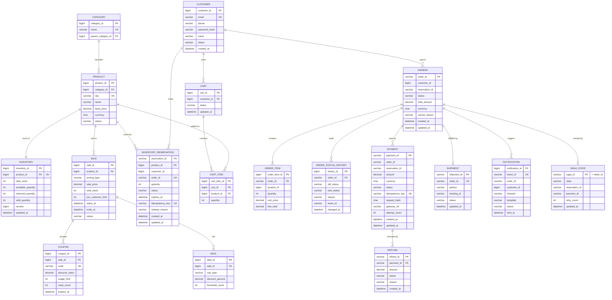
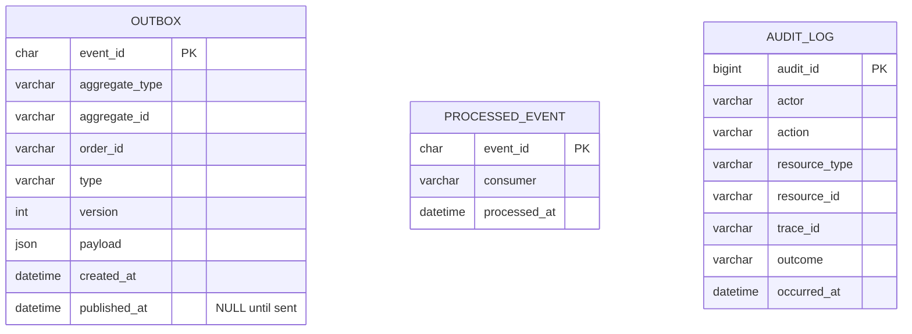

# SALESTORM – Database / ER Design

**Principle:** each service owns its own schema (database-per-service). No service reads another service's tables; cross-service references are by ID only (no cross-database foreign keys). Foreign keys below are enforced **inside** a service's own database.

| Service | Owned tables |
|---|---|
| Customer/Auth | CUSTOMER |
| Product/Sale | CATEGORY, PRODUCT, SALE, DEAL, COUPON |
| Cart | CART, CART_ITEM |
| Inventory-Reservation | INVENTORY, INVENTORY_RESERVATION, OUTBOX, PROCESSED_EVENT |
| Checkout | SAGA_STATE, OUTBOX, PROCESSED_EVENT |
| Payment | PAYMENT, REFUND, OUTBOX, PROCESSED_EVENT |
| Order | ORDERS, ORDER_ITEM, ORDER_STATUS_HISTORY, OUTBOX, PROCESSED_EVENT |
| Shipment | SHIPMENT |
| Notification | NOTIFICATION |
| Platform | AUDIT_LOG |

---

## 1. ER Diagram

Outbox, processed-event and audit tables are shown separately (section 4) to keep the diagram readable.

---

## 2. Keys, Constraints and Indexes (concurrency- and money-critical tables)

### INVENTORY
| Item | Definition |
|---|---|
| PK | `inventory_id` |
| Unique | `product_id` (one row per product) |
| Check | `available_quantity >= 0`, `reserved_quantity >= 0`, `sold_quantity >= 0` |
| Check | `available_quantity + reserved_quantity + sold_quantity = total_stock` |
| Concurrency | Conditional update: `UPDATE inventory SET available=available-1, reserved=reserved+1 WHERE product_id=? AND available>0`. `version` is incremented for audit and diagnostics, not used for locking. |

### INVENTORY_RESERVATION
| Item | Definition |
|---|---|
| PK | `reservation_id` |
| FK | `product_id` → INVENTORY.product_id |
| Unique | `idempotency_key` (duplicate Buy Now request) |
| Unique | `order_id` (one reservation per purchase) |
| Unique (business) | One **active** reservation per customer per product. MySQL: generated column `active_key = IF(status IN ('RESERVED','PAYMENT_PENDING','CONFIRMED'), CONCAT(customer_id,'-',product_id), NULL)` with a unique index on it (NULLs are not compared, so released/sold rows never conflict). |
| Check | `status IN ('RESERVED','PAYMENT_PENDING','CONFIRMED','SOLD','RELEASED')`; `quantity > 0` |
| Index | (`status`, `expires_at`) for the expiry scan |
| Index | (`customer_id`, `product_id`) for lookups |
| Status change | Always conditional: `UPDATE ... SET status=:new WHERE reservation_id=? AND status=:expected` |

### PAYMENT
| Item | Definition |
|---|---|
| PK | `payment_id` (also sent to the gateway as merchant reference / idempotency key) |
| Unique | `idempotency_key` |
| Unique (business) | One active payment per reservation (generated-column technique as above, active = INITIATED, PROCESSING, TIMEOUT, SUCCEEDED) |
| Check | `amount > 0`; `status IN (INITIATED, PROCESSING, SUCCEEDED, FAILED, TIMEOUT, REFUND_PENDING, REFUNDED)` |
| Index | (`status`, `updated_at`) for the reconciler (TIMEOUT / stuck PROCESSING) |
| Index | `order_id`, `reservation_id` |
| Note | `request_hash` stores a hash of (reservation_id, amount); same key with a different hash returns 409 |

### REFUND
| Item | Definition |
|---|---|
| PK | `refund_id` |
| FK | `payment_id` → PAYMENT |
| Unique | (`payment_id`) for full refunds (refund exactly once) |

### ORDERS / ORDER_ITEM / ORDER_STATUS_HISTORY
| Item | Definition |
|---|---|
| PK | `order_id` (generated by Checkout at Buy Now) |
| FK | `ORDER_ITEM.order_id`, `ORDER_STATUS_HISTORY.order_id` → ORDERS |
| Unique | (`order_id`, `event_id`) on history, so a replayed event cannot write a second history row |
| Index | (`customer_id`, `created_at`) for "my orders"; (`status`, `updated_at`) for the order reconciler |
| Rule | Status moves only forward through the state machine; history row inserted in the same transaction as the status change |

### SALE / DEAL / COUPON
| Item | Definition |
|---|---|
| PK / FK | `sale_id`; `DEAL.sale_id` and `COUPON.sale_id` → SALE |
| Unique | `COUPON.code` |
| Check | `starts_at < ends_at`; `discount_percent BETWEEN 0 AND 100` |
| Note | `pricing_type` selects the `PricingStrategy` (FLAT, DEAL, COUPON, EARLY_BIRD). Price is computed once at checkout and stored on ORDER_ITEM and PAYMENT. |

### Other tables
| Table | Key points |
|---|---|
| CUSTOMER | Unique `email`; passwords stored only as salted hash (bcrypt/argon2) |
| CART / CART_ITEM | Unique (`cart_id`, `product_id`); cart is not a stock hold |
| SHIPMENT | Unique `order_id`; index on `tracking_id` |
| NOTIFICATION | Unique `event_id` (deduplicates at-least-once delivery) |
| SAGA_STATE | PK `saga_id` = `order_id`; index (`state`, `updated_at`) for the watchdog |

---

## 3. Transaction Boundaries (database view)

| Transaction | Service | Contents (all in one local ACID transaction) |
|---|---|---|
| T1 Reserve | Inventory | INSERT reservation, UPDATE inventory buckets (conditional), INSERT outbox `ReservationCreated` |
| T2 Confirm | Inventory | UPDATE reservation → CONFIRMED (conditional), INSERT outbox, INSERT processed_event |
| T3 Sell | Inventory | UPDATE reservation → SOLD, reserved−1, sold+1, INSERT outbox |
| T4 Release | Inventory | UPDATE reservation → RELEASED (conditional), available+1, reserved−1, INSERT outbox |
| P1 | Payment | INSERT payment (INITIATED) with idempotency key |
| P2 | Payment | UPDATE payment status, INSERT outbox |
| O1 | Order | INSERT/UPDATE order, INSERT status history, INSERT outbox, INSERT processed_event |

Never inside a transaction: Redis calls, Kafka publish, gateway calls, HTTP calls to other services.

---

## 4. Reliability Tables

| Table | Purpose | Index / rule |
|---|---|---|
| OUTBOX | Events written in the same transaction as the state change | Index (`published_at`, `created_at`) so the publisher reads unpublished rows in order; cleaned after retention period |
| PROCESSED_EVENT (inbox) | Consumer idempotency: insert `event_id` and apply the change in one transaction; duplicate insert fails and the event is skipped | PK (`event_id`, `consumer`) |
| AUDIT_LOG | Append-only record of sensitive actions (admin cancel, refund, config change); no UPDATE/DELETE permission for the application user | Index (`resource_type`, `resource_id`) |

---

## 5. Consistency, Scaling and Retention of Data

| Topic | Decision |
|---|---|
| Engine | MySQL 8 (InnoDB), strong ACID per service. NoSQL is used only for Redis (counters, idempotency, rate limits) and Kafka (events); see ADR. |
| Hot row | INVENTORY row for one product is the only contended row; Redis gate limits writes to about 100. |
| Read scaling | Product, sale and order-history reads use read replicas and cache; inventory and payment writes always go to the primary. |
| Partitioning | ORDERS, PAYMENT, NOTIFICATION partitioned by month or hashed by `order_id` when volume grows; OUTBOX purged after publish plus retention. |
| Backups | Daily full plus binlog for point-in-time recovery; RPO of a few seconds with synchronous or semi-synchronous replica. |
| Money | `DECIMAL(12,2)` with explicit currency; never floating point. |
| PII | Customer PII only in CUSTOMER; other services hold `customer_id`. Payment card data is never stored (gateway tokenisation). |
