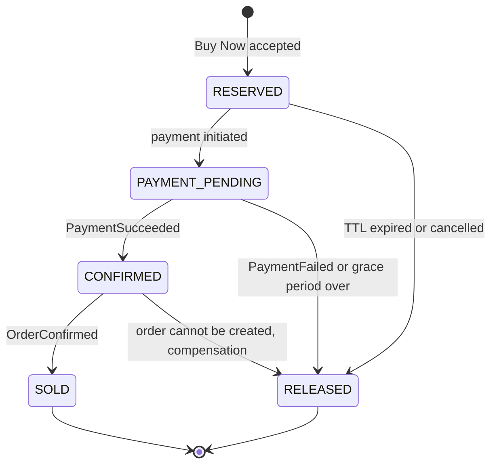

# SALESTORM – Stage 3: Concurrency & Inventory Design

**Scenario:** Product X, 100 units, 10,000 simultaneous "Buy Now" requests, 2% duplicates, 5% payment failures.

**One-line design:** *Redis is the fast gatekeeper (sheds 9,900 requests cheaply). MySQL is the final truth (guarantees correctness even if Redis is wrong).*

---

## 1. Inventory Invariant

For every product, at all times:

```
total_stock = available_quantity + reserved_quantity + sold_quantity
available_quantity >= 0
sold_quantity <= total_stock (100)
```

Every operation (reserve, confirm, release, sell) moves units between these three buckets inside one DB transaction, so the invariant cannot be broken half-way.

| Bucket | Meaning |
|---|---|
| available | Can be reserved by a new customer |
| reserved | Held by a reservation (RESERVED, PAYMENT_PENDING or CONFIRMED) |
| sold | Order confirmed; permanent |

---

## 2. Comparison of Concurrency-Control Approaches

| # | Approach | How it works | Advantages | Disadvantages for SALESTORM |
|---|---|---|---|---|
| A | **Pessimistic locking** (row lock on the inventory row) | First request locks the row; other 9,999 wait | Simple, always correct | 10,000 threads queue on one row, connection pool exhausted, high latency, DB becomes the bottleneck |
| B | **Optimistic locking** (version column) | Everyone reads, update succeeds only if version unchanged | No long locks | Near the end most requests fail and retry, retry storm multiplies DB load |
| C | **Atomic conditional DB update** (decrement only where available > 0) | One statement; DB serialises it | Correct, no version needed | All 10,000 still reach the same DB row |
| D | **Redis atomic gate + DB conditional update (SELECTED)** | Redis single-threaded atomic check admits only 100; the DB performs a conditional update for those | Sold-out rejection in under 50 ms, DB sees about 100 writes, DB constraint is safety net | Two stores to keep aligned (drift risk), more moving parts |

### Why D is selected
1. The real problem is **contention on one hot row**. D removes 9,900 of 10,000 requests before they touch the database.
2. Correctness does not depend on Redis: the DB conditional update and a non-negative check constraint are the last line of defence.
3. Redis can only be wrong in the **safe direction** by design (see section 9), so the worst case is under-selling temporarily, never overselling.

### What D sacrifices (state this to the jury)
- Extra complexity: two sources of state and a reconciliation job.
- Redis failure temporarily pauses the gate (fail closed, "try again").
- Eventual, not instant, agreement between Redis counter and MySQL.

---

## 3. Data Model (concurrency-critical parts)

**INVENTORY**: `inventory_id` (PK), `product_id` (unique), `available_quantity`, `reserved_quantity`, `sold_quantity`, `version` (audit and diagnostics), `updated_at`. Constraints: non-negative on all three quantities; sum equals total.

**INVENTORY_RESERVATION**: `reservation_id` (PK), `product_id` (FK), `customer_id` (FK), `quantity`, `status`, `expires_at`, `idempotency_key`, `release_reason`, `created_at`, `updated_at`.
- Unique: `idempotency_key`.
- Unique rule: one **active** reservation per customer per product (active = RESERVED, PAYMENT_PENDING, CONFIRMED).
- Index: (`status`, `expires_at`) for the expiry scan.

**OUTBOX**: `event_id`, `aggregate_id`, `type`, `payload`, `created_at`, `published_at` – written in the same transaction as the state change.

**Redis keys (logical):** stock counter per product, idempotency key to result, expiry sorted set, per-user rate counters.

---

## 4. Reservation State Machine



Matches the brief: `AVAILABLE → RESERVED → PAYMENT_PENDING → CONFIRMED → SOLD`, with failure paths `PAYMENT_FAILED → RELEASED` and `TIMEOUT → RELEASED`.

| State | Meaning | Expiry applies? | Stock bucket |
|---|---|---|---|
| RESERVED | Unit held, customer not yet paying | Yes, TTL 5 min | reserved |
| PAYMENT_PENDING | Payment in progress | Yes, but extended while payment outcome is unknown (grace) | reserved |
| CONFIRMED | Payment succeeded; unit permanently held | **No** (protected from expiry job) | reserved |
| SOLD | Order confirmed | No | sold |
| RELEASED | Hold ended (reason stored) | n/a | back to available |

---

## 5. Lifecycle Operations

### 5.1 Reservation creation (Buy Now)
1. **Gateway:** validate JWT, apply per-user rate limit, require an idempotency key.
2. **Idempotency check:** if the key already exists, return the stored result. No new work.
3. **Redis gate:** one atomic step decrements the stock counter only if it is above zero. Zero means immediate `409 SOLD_OUT` (or "temporarily unavailable", see section 9).
4. **MySQL transaction T1 (single local transaction):**
   - insert reservation (RESERVED, `expires_at` = now + 5 min, idempotency key);
   - move one unit available → reserved, **only if available > 0**;
   - insert outbox event `ReservationCreated`.
5. **Commit**, then respond with reservation id and expiry time.
6. **If T1 fails** (constraint, 0 rows updated, DB error): compensate by giving the unit back to the Redis counter, store a failed result against the idempotency key where appropriate, and respond with failure.

### 5.2 Confirmation (two steps, matching CONFIRMED then SOLD)
- **On `PaymentSucceeded`:** transaction T2 changes reservation PAYMENT_PENDING/RESERVED → **CONFIRMED** (only if still active), clears expiry protection, writes outbox. Stock stays in `reserved`.
- **On `OrderConfirmed`:** transaction T3 changes CONFIRMED → **SOLD**, moves one unit reserved → sold, writes outbox.
- Both are idempotent: a repeated event finds the target status already set and does nothing.

### 5.3 Expiry
1. A scheduler runs every few seconds and picks reservations with status RESERVED (or PAYMENT_PENDING past grace) and `expires_at` in the past, in small batches.
2. Per reservation, transaction T4: status → RELEASED (reason TIMEOUT) **conditional on status still being releasable**; available +1, reserved −1; outbox `ReservationExpired`.
3. **After commit**, add the unit back to the Redis counter.
4. Target: release within 30 s of expiry.

### 5.4 Release (payment failed or cancelled)
Same transaction as expiry with reason PAYMENT_FAILED or CANCELLED, triggered by the `PaymentFailed` or cancel event.

---

## 6. Last-Item Scenario (two customers, one unit)

1. Redis counter = 1; both requests arrive at the same moment.
2. Redis executes the check-and-decrement atomically, one request at a time. The first sees 1 → 0 and passes; the second sees 0 and gets `409`.
3. The winner's MySQL transaction decrements available from 1 to 0 and creates the reservation.
4. **If Redis were wrong** (crash, drift), both would reach MySQL, but the conditional update affects 0 rows for the second request, so its transaction fails and it is rejected.

**Jury answer to "where exactly is consistency guaranteed?":** in the MySQL inventory row, via the conditional update (only decrement when available > 0) and the non-negative constraint, inside the same transaction as the reservation record. Redis only reduces how many requests get there.

---

## 7. Duplicate Reservation Handling

Three defensive layers (2% of 10,000 = about 200 duplicates):

| Layer | Mechanism | Catches |
|---|---|---|
| 1. Gateway / Redis | Idempotency key stored set-if-absent with result | Double click, client retry, network retry with same key |
| 2. Business rule | One active reservation per customer per product (unique rule in DB) | Same customer, different key |
| 3. DB constraint | Unique `idempotency_key` on reservation | Redis lost or bypassed |

**Behaviour for a duplicate:** returns the **same** reservation id and status, never a second unit. If the first request is still processing, the duplicate receives "in progress" (retry shortly) and does **not** start a second reservation.

**Same key but different payload** → rejected as a conflict (client bug), not silently merged.

---

## 8. Transaction Boundaries & Consistency Guarantees

### Inside one local ACID transaction (Inventory DB only)
- Reservation row change + inventory bucket change + outbox row.

### Never inside a transaction
- Redis calls, Kafka publishing, payment gateway calls, HTTP calls to other services (they would hold locks for long and block the hot row).

### Across services
- Eventual consistency using **Outbox + Kafka + idempotent consumers + Saga** (Stage 4). Each step is safe to retry.

| Guarantee | Level | Enforced by |
|---|---|---|
| Successful sales never exceed 100 | **Strict** | Conditional update + constraint |
| Inventory never negative | **Strict** | Non-negative constraint |
| Invariant available + reserved + sold = total | **Strict** | Same-transaction bucket moves |
| One idempotency key = one reservation | **Strict** | Unique constraint |
| Reservation state transitions are valid | **Strict** | State machine + conditional status update |
| Redis counter equals MySQL available | Eventual | Reconciler |
| Expired holds released within 30 s | Target | Scheduler |
| Stock number shown on UI is current | Target (may be stale) | Cache |

---

## 9. Redis ↔ MySQL Drift and Failure Handling

**Safety rule:** Redis may only ever be *lower than or equal to* MySQL available (conservative). Redis higher than MySQL is blocked by the DB conditional update.

| Failure | Effect | Handling |
|---|---|---|
| Redis crashes / restarts | Gate unavailable | Fail closed ("try again"); rebuild counter from MySQL `available`, then reopen |
| Redis decremented but MySQL transaction failed | Redis lower than truth (under-sell) | Compensate counter +1 immediately; reconciler corrects any miss |
| MySQL committed a release but Redis +1 was lost | Redis lower than truth | Reconciler compares and fixes periodically |
| Redis wrongly higher (e.g. restored stale snapshot) | Extra requests reach DB | DB conditional update rejects them, so no oversell |
| Two expiry workers pick the same reservation | Possible double release | Conditional status update lets only one succeed |
| Duplicate Kafka event | Possible double confirm/release | Idempotent consumers (status already final means ignore) |
| DB failover during reservation | Request fails or is uncertain | Client retries with same idempotency key; unique key prevents double reservation |

**"Sold out" vs "temporarily unavailable":** when the counter hits zero but reservations are still unpaid, show "temporarily unavailable, check back" because up to 5% of reservations fail payment and units return. Show "sold out" only when `available = 0` and `reserved = 0`.

---

## 10. Behaviour at the Test Numbers

| Step | Result |
|---|---|
| 10,000 requests, 2% duplicates | Duplicates return the original result, so about 9,800 unique customers compete |
| Redis gate | 100 pass; about 9,700 rejected quickly with `409` |
| MySQL | About 100 reservation transactions |
| Payments | 95 succeed → CONFIRMED → SOLD; 5 fail → RELEASED, 5 units return to the pool |
| Returned units | Waiting or new customers can reserve those 5 units; final sold count never exceeds 100 |

**Evidence to show the jury (optional simulation):** 10,000 concurrent clients, 100 units, 2% repeated keys, 5% payment failures. Expected result: confirmed plus still-held is at most 100, no negative stock, duplicates map to the same reservation, expired holds return to the pool.
