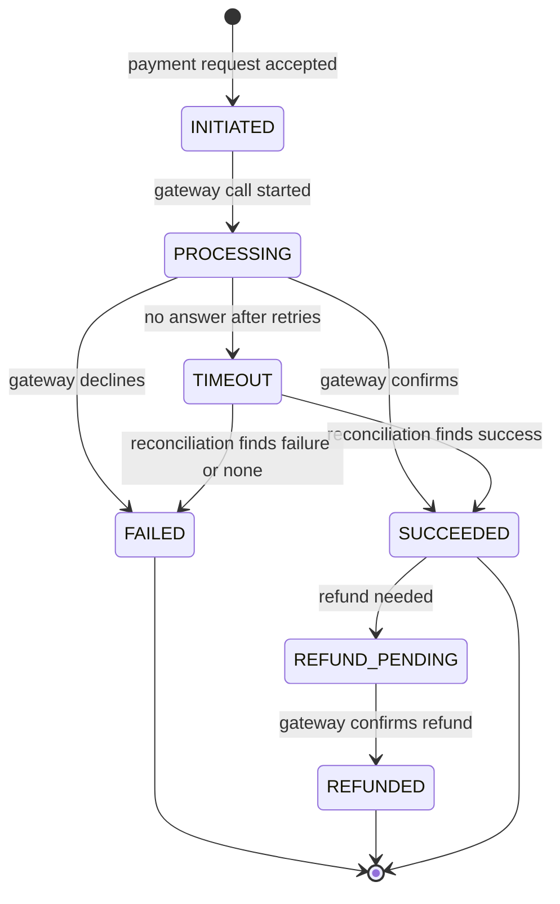
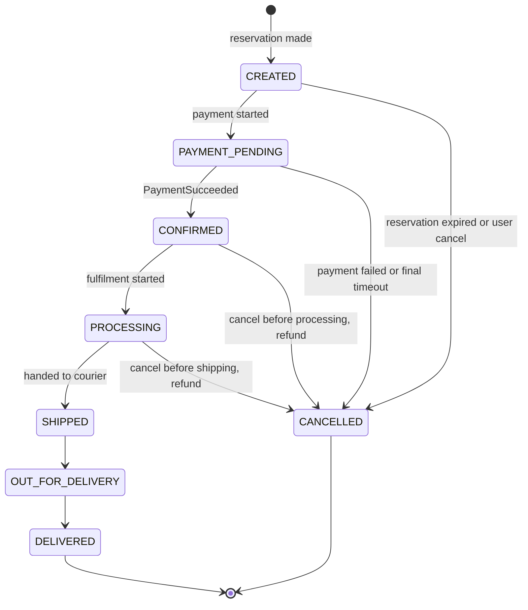
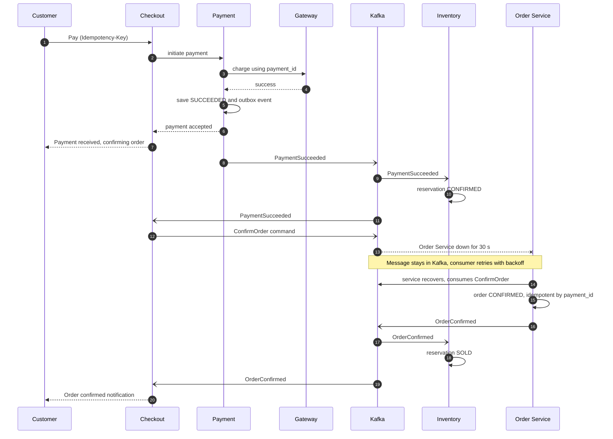

# SALESTORM – Stage 4: Payment & Order Design

**Core principle:** money and stock are never lost or duplicated. Every step is **idempotent**, every external call has a **timeout**, and every uncertain outcome is resolved by **reconciliation**, not by guessing.

---

## 1. Ownership and Identifiers

| Concept | Owner | Identifier |
|---|---|---|
| Reservation | Inventory Service | `reservation_id` |
| Payment | Payment Service | `payment_id` (also the merchant reference sent to the gateway) |
| Order | Order Service | `order_id` (generated by Checkout at Buy Now, so every service can correlate) |
| Saga | Checkout Service | `saga_id` (equals `order_id`) |

One `trace_id` flows through all of them.

---

## 2. Payment State Machine

`TIMEOUT` means **outcome unknown**, which is different from failed. We never release money or stock based on a guess.

---

## 3. Payment Flows

### 3.1 Duplicate-payment prevention (idempotency)

| Layer | Mechanism |
|---|---|
| Client / Gateway | Client sends an `Idempotency-Key` (derived from `reservation_id`). Same key returns the stored response. |
| Payment DB | Unique constraint on `idempotency_key`; also at most one active payment per reservation. |
| Payload check | Store a hash of the request; same key with a different amount or reservation is rejected as a conflict. |
| External gateway | `payment_id` is sent as the gateway's merchant reference / idempotency key, so even a retried gateway call cannot charge twice. |
| Kafka consumers | `PaymentSucceeded` is processed once per `payment_id`; repeats are ignored. |

### 3.2 Transaction boundaries inside Payment Service
1. **Local transaction P1:** insert payment (INITIATED) + idempotency key. Commit.
2. **Outside any transaction:** call the gateway (timeout, retry, circuit breaker).
3. **Local transaction P2:** update status (SUCCEEDED, FAILED or TIMEOUT) + insert outbox event. Commit.

The gateway call is never inside a DB transaction, so a slow gateway cannot hold database locks.

### 3.3 Payment success
1. Gateway confirms → P2 sets SUCCEEDED and writes outbox `PaymentSucceeded` (with `payment_id`, `order_id`, `reservation_id`, amount).
2. Outbox publisher sends it to `payment.events`.
3. Inventory: reservation → **CONFIRMED** (stock held permanently).
4. Checkout saga: moves to PAID and sends `ConfirmOrder` command to Order Service.
5. Order Service: order → **CONFIRMED**; emits `OrderConfirmed`.
6. Inventory: reservation → **SOLD**.
7. Notification: "Order confirmed".

### 3.4 Payment failure
1. Gateway declines (insufficient funds, card rejected) → FAILED. A decline is a final answer, so **no retry**.
2. `PaymentFailed` event published.
3. Inventory releases the reservation (reason PAYMENT_FAILED); unit returns to available and Redis counter.
4. Checkout saga ends as FAILED; Order Service marks order **CANCELLED** (reason PAYMENT_FAILED).
5. Notification: "Payment failed". The customer may start again if stock is still available.

### 3.5 Payment timeout (outcome unknown)

| Step | Behaviour |
|---|---|
| Timeout per attempt | 3 seconds |
| Retry | Only for timeouts and 5xx errors, max 3 attempts, exponential backoff with jitter (for example 200 ms, 400 ms, 800 ms). **Same `payment_id`** every time, so retries are safe. |
| After retries exhausted | Mark `TIMEOUT`; return "payment being verified" to the customer. |
| Reservation | **Extended by a grace period** (for example up to 10 minutes total) while the payment is unknown, so stock is not released before we know. |
| Reconciliation | Payment Reconciler queries the gateway by `payment_id` at intervals (for example 15 s, 1 min, 5 min) and also accepts gateway webhooks. |
| Resolved success | → SUCCEEDED → normal success flow. |
| Resolved failure or gateway says "no such payment" at the end of the grace period | → FAILED → release reservation. |
| Success arrives after the reservation was already released | See section 5.3 (re-reserve if possible, otherwise refund). |

### 3.6 Circuit breaker, timeout and retry policy

| Parameter | Value |
|---|---|
| Timeout | 3 s per gateway call |
| Retry | 3 attempts, exponential backoff + jitter, only for timeout/5xx |
| Circuit opens | Failure rate at or above 50% over the last 10 calls (matches Stage 1) |
| Open duration | 30 s, then half-open |
| Half-open | 3 probe calls; success closes the circuit, failure reopens |
| Bulkhead | Dedicated thread pool/connection limit for the gateway, so a slow gateway cannot starve other endpoints |

**While the circuit is open:** fail fast with `503` and `Retry-After`; **do not** create a charge and do **not** release the reservation. The customer can retry payment while the reservation is still valid. If the outage outlasts the TTL, the reservation expires normally and stock returns.

**Gateway down for a long time:** keep the sale running only if the gateway recovers within the reservation window; otherwise alert, optionally pause the sale, and let reservations expire safely.

---

## 4. Order State Machine

### Transition rules

| From | To | Trigger | Who |
|---|---|---|---|
| (none) | CREATED | `CreateOrder` command at Buy Now | Checkout → Order |
| CREATED | PAYMENT_PENDING | `PaymentInitiated` | Checkout → Order |
| PAYMENT_PENDING | CONFIRMED | `ConfirmOrder` (after `PaymentSucceeded`) | Checkout → Order |
| CONFIRMED | PROCESSING | Warehouse picks order | Shipment event |
| PROCESSING | SHIPPED | Courier handover | Shipment event |
| SHIPPED | OUT_FOR_DELIVERY | Courier update | Delivery partner event |
| OUT_FOR_DELIVERY | DELIVERED | Delivery confirmed | Delivery partner event |
| CREATED / PAYMENT_PENDING | CANCELLED | Payment failed, expiry, user cancel | Checkout or user |
| CONFIRMED / PROCESSING | CANCELLED | User or admin cancel before shipping | Order (triggers refund) |

### Rules enforced by the State pattern
- Only the transitions above are legal; anything else is rejected and logged.
- **No cancellation after SHIPPED**; that becomes a return flow (out of scope, noted as an extension).
- Every transition is stored in an **order status history** table (old state, new state, reason, event id, timestamp) for audit.
- Transitions are **idempotent and monotonic**: repeating an event for a state already reached is ignored; an event for an earlier state than the current one is ignored.

### Cancellation and refund
- Cancel in CONFIRMED or PROCESSING → order CANCELLED → `OrderCancelled` event → Payment issues refund (SUCCEEDED → REFUND_PENDING → REFUNDED) → Inventory returns the unit (SOLD or CONFIRMED → RELEASED, available +1 and Redis +1) → Notification.
- Refund is idempotent (unique refund reference per `payment_id`).

---

## 5. Payment Success Followed by Order Service Failure

### 5.1 Why nothing is lost
`PaymentSucceeded` is written to the **outbox in the same transaction** as the payment status, so it exists even if every other service is down. Kafka stores it durably. The `ConfirmOrder` command is likewise outbox-published and durable.

### 5.2 Recovery layers

| Layer | Mechanism | Covers |
|---|---|---|
| 1. Kafka durability | Command waits in the topic; consumer resumes from its offset | Short outage (the 30 s test case) |
| 2. Consumer retry | 3 retries with backoff, then dead-letter topic | Transient errors, poison messages |
| 3. Idempotent consumer | `ConfirmOrder` processed once per `payment_id`; creates the order if absent, so an earlier lost `CreateOrder` does not matter | Duplicates, redelivery, out-of-order |
| 4. Saga watchdog | Checkout checks every saga in PAID without `OrderConfirmed` after 60 s and re-sends the command; raises an alert after repeated failure | Lost or stuck commands |
| 5. Order reconciler | Periodic job finds payments SUCCEEDED with no CONFIRMED order older than a threshold and re-emits | Anything the saga missed |
| 6. DLQ handling | Dead-letter messages alerted and replayed by an operator tool (safe because consumers are idempotent) | Bugs, bad data |
| 7. Compensation (last resort) | If the order can never be created (permanent validation error) → refund payment, release reservation (CONFIRMED → RELEASED), notify the customer | Unrecoverable cases |

### 5.3 Related race: payment succeeds after the reservation was released
1. `PaymentSucceeded` arrives; Inventory sees the reservation is RELEASED.
2. Try to **re-reserve**: conditional update only if available > 0. If it works → reservation CONFIRMED and the flow continues.
3. If stock is gone → emit `RefundRequired`; Payment refunds (REFUND_PENDING → REFUNDED); customer notified.
4. Winner is decided purely by the DB conditional update, so there is never a sale beyond 100.

### 5.4 Customer experience during the outage
Status shows "Payment received, confirming your order". The order page reads the Order/Saga status; if Order Service is down the page shows the saga state (PAID) rather than an error. Target: confirmation within 5 s normally and within 60 s during a 30 s outage.

---

## 6. Practical Test Case Traces (for the jury demonstration)

**Setup:** stock 100, 10,000 users, payment 95% success / 5% failure, 2% duplicates, Order Service down 30 s.

| Trace | What happens |
|---|---|
| **Successful purchase** | Buy Now → idempotency check → Redis gate pass → MySQL reservation RESERVED (5 min TTL) → pay → gateway success → payment SUCCEEDED → reservation CONFIRMED → order CONFIRMED → reservation SOLD → notification |
| **Failed payment** | Gateway declines → payment FAILED → `PaymentFailed` → reservation RELEASED, available +1, Redis +1 → order CANCELLED → customer notified; the unit can be bought by someone else |
| **Duplicate Buy request** | Same idempotency key → stored result returned → same reservation id, no extra unit, no extra payment |
| **Duplicate payment click** | Same payment key → existing payment returned; gateway sees the same `payment_id`, so no second charge |
| **Payment success then Order Service down** | Section 5: events wait in Kafka, order confirmed after recovery, no lost order, no double order |
| **Inventory reaches zero** | Redis gate rejects instantly with `409` ("temporarily unavailable" while unpaid reservations exist, "sold out" when none) |
| **Traffic 50x** | Edge scaling and Redis gate absorb the extra load; payments and orders stay bounded by 100 units, so Payment/Order load does not grow with traffic |
| **Database failure** | Fail over to replica; in-flight requests retry with idempotency keys; outbox resumes publishing; reconcilers repair any gaps |
| **Payment gateway failure** | Circuit opens, fail fast, reservations preserved until TTL, reconciler resolves unknown payments after recovery |

---

## 7. Failure Matrix

| Failure | Detection | Automatic response | Final guarantee |
|---|---|---|---|
| Gateway slow | 3 s timeout | Retry with same `payment_id` | No double charge |
| Gateway down | Breaker opens | Fail fast, keep reservation | Stock safe, retry within TTL |
| Gateway answer lost | TIMEOUT state | Reconcile via status query/webhook | Payment resolved exactly once |
| Payment DB down | Write error | Return 503; no charge started | No money taken without a record |
| Crash after charge but before saving result | Payment stuck in PROCESSING | Reconciler queries gateway by `payment_id` | Result recovered |
| Kafka down | Publish lag | Outbox keeps events; publisher retries | No event lost |
| Order Service down | Consumer lag alert | Messages wait; watchdog retries | Paid order always becomes CONFIRMED or refunded |
| Duplicate/replayed message | Status already final | Ignore | Idempotent |
| Poison message | 3 retries failed | Dead-letter topic, alert | Operator replay |

---

## 8. Consistency Summary (Stage 4)

| Guarantee | Level |
|---|---|
| No duplicate payment for one reservation | **Strict** (unique key + gateway idempotency) |
| Every successful payment ends in a confirmed order or a refund | **Strict** (eventual) |
| No order for an unpaid reservation reaches CONFIRMED | **Strict** (state machine) |
| Valid order transitions only, with audit history | **Strict** |
| Order confirmation latency | Target: under 5 s normal, under 60 s during an outage |
| Refund completion time | Target (depends on gateway) |

**Trade-off:** the design accepts a short period where the customer has paid but the order is not yet confirmed (eventual consistency) in exchange for never blocking or losing payments when Order Service is down. Reconciliation jobs add operational complexity but are the reason the strict guarantees hold under failure.
